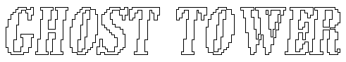
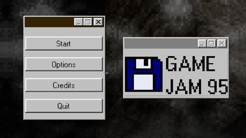

 

 

### A 3D horror game with point-and-click mechanics, made in [Godot](https://godotengine.org/) for [Game Jam 95](https://itch.io/jam/game-jam-95).

## About
<b>GHOST TOWER</b> is a surreal horror game, with 3D low-poly graphics reminiscent of 90s horror games.

Use point-and-click GUI systems inspired by Windows 95 to navigate menus, manage your inventory, and make it out of the dreaded ghost tower in one piece.

 

Oh, and there's a slot machine minigame!

## Compiling
### Godot
This game was made with [Godot](https://godotengine.org/), and must be installed in order to modify the game.

[Godot v4.7.2](https://godotengine.org/download/archive/4.7.2-stable/) was used, versions below will be incompatible with the project files.

## Downloads
Download the initial game jam release of the game in [releases](https://github.com/SnowmanSixtyFour/GhostTowerGameJam/releases).

Alternatively, download the game on [itch.io](https://snowman64.itch.io/ghost-tower) or [Game Jolt](https://gamejolt.com/games/ghost-tower/1121497).

## Credits
- [Snowman64](https://bsky.app/profile/snowman64.com) - Creator, Programmer
- [41popzic](https://soundcloud.com/41popzic) - Music

<b>For extended credits, view the RichTextLabel in the credits window node in [main_menu.tscn](https://github.com/SnowmanSixtyFour/GhostTowerGameJam/blob/main/Scenes/Game/main_menu.tscn).</b>

### Copyright
Copyright (c) 2026 Snowman64, under the [GNU General Public License v3.0](https://www.gnu.org/licenses/gpl-3.0.en.html).